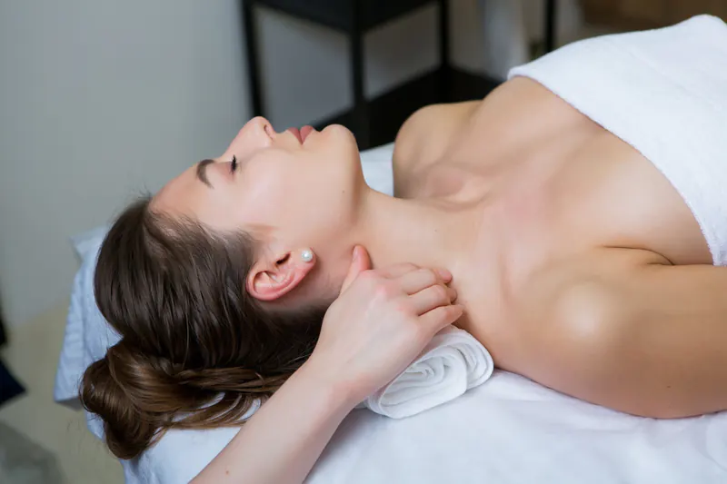

# MEDIA PACK — Lepa Svaki Dan v2

`_shared/img/` · 50 webp fajlova · 2168 KB ukupno · generisano 2026-10-07

Fotografije: webp 480/800/1200/1800 (samo širine ≤ izvora), kvalitet 78, metapodaci uklonjeni. Isečak: webp sa alfom 600/900/1300 (q85). Logotipi: lossless webp u izvornoj širini. Placeholder (24px, zamućen, base64) je u `manifest.json` (`placeholder`).

```html

```

## Pregled slika

| Slika | Izvor (px) | Varijante (px) | KB po varijanti | Ton | Alt tekst (sr) | Najbolja upotreba |
|---|---|---|---|---|---|---|
| `hero-cutout-{600, 900, 1300}.webp` | 2688×3024 → trim 2031×3001 (9632.5 KB) | 600×887 / 900×1330 / 1300×1921 | 70.8 / 135.6 / 244.5 | srednja (0.33), #67514c | Nasmejana žena duge talasaste kose u tamnoplavom sakou, prekrštenih ruku. | Hero isečak desno od naslova (lila #C7B5D8 / charcoal #454340 / bela). Dno slike je ravan rez - sidriti ga na dno sekcije ili ispod gradijenta. |
| `hero-orhideja-{480, 800, 1200, 1800}.webp` | 1920×1080 (187.3 KB) | 480×270 / 800×450 / 1200×675 / 1800×1012 | 5.1 / 10.6 / 19 / 33.5 | svetla (0.90), #efe2d9 | Bele orhideje sa ljubičasto-ružičastim središtem i latice koje lebde na toplo krem pozadini. | HERO svetlih tema (luksuz/editorial) - naslov desno. Dobro se slaže sa lila + zlatnim akcentom. Bez lica - preklop se sme staviti bilo gde. |
| `about-{480, 800, 1200, 1800}.webp` | 2000×1333 (312.4 KB) | 480×320 / 800×533 / 1200×800 / 1800×1200 | 8.8 / 17.9 / 31.2 / 60 | svetla (0.56), #988d8a | Žena zatvorenih očiju opušteno leži na tretmanskom stolu dok joj terapeut masira vrat i rame, na belim peškirima. | Sekcija "O nama" / filozofija, tretmani vrata i ramena, masaža. Dobar za svetle (white/lila) teme; široki 3:2 kadar. |
| `cta-bg-{480, 800, 1200, 1800}.webp` | 1920×1279 (713.3 KB) | 480×320 / 800×533 / 1200×799 / 1800×1199 | 14.6 / 26.2 / 42.6 / 78.3 | tamna (0.28), #5d4132 | Terapeutkinja masira glavu i vrat klijentkinje u toplo osvetljenom prostoru sa svećama, biljkom i drvenim policama. | Pozadina CTA trake / footera ispod tamnog ili lila preklopa (u trenutnom sajtu: opacity .4 + lila gradient). Dekorativno: alt="" ako je čista pozadina. |
| `founder-portrait-{480, 800}.webp` | 1000×1500 (243.1 KB) | 480×720 / 800×1200 | 16.6 / 31.7 | svetla (0.57), #a68f7e | Nanošenje tamne maske za lice četkicom na čelo žene koja opušteno leži, u svetlom prostoru sa biljkama. | Tretmani lica / maske / nega kože, vertikalni 2:3 ili 4:5 kadar. NIJE portret osnivača. |
| `location-novi-beograd-{480, 800, 1200, 1800}.webp` | 2000×2000 (411.6 KB) | 480×480 / 800×800 / 1200×1200 / 1800×1800 | 15.4 / 28.6 / 48.3 / 84.7 | srednja (0.44), #8a6a5b | Terapeut masira leđa klijentkinje toplim biljnim jastučićima u svetlom salonu sa zelenim zidom. | Kartica lokacije (Novi Beograd/Beauty) ili "tretmani tela" - topla masaža. Kvadrat 1:1, dobro se seče u 4:5 i 3:4. |
| `location-waterfront-{480, 800, 1200, 1800}.webp` | 2000×1142 (252.1 KB) | 480×274 / 800×457 / 1200×685 / 1800×1028 | 9.8 / 18.3 / 30.4 / 51.1 | srednja (0.49), #9c775a | Žena zatvorenih očiju meditira u sedećem položaju na krznenom tepihu, okružena upaljenim svećama u toplo osvetljenoj sobi. | Wellbeing / meditacija / Waterfront kartica lokacije, topli tamniji hero. Široki 16:9. |
| `vertical-body-{480, 800, 1200, 1800}.webp` | 2000×1333 (236.6 KB) | 480×320 / 800×533 / 1200×800 / 1800×1200 | 10 / 18.3 / 29.6 / 50.4 | svetla (0.66), #c4a580 | Staklene bočice sa uljima za masažu, sveće, kamenje i biljni jastučić na drvenom poslužavniku, a u pozadini zamućena žena odmara. | Aromaterapija / ulja / tretmani tela, prodaja proizvoda (retail). 3:2. |
| `vertical-esthetic-{480, 800, 1200, 1800}.webp` | 2000×1334 (299.5 KB) | 480×320 / 800×534 / 1200×800 / 1800×1201 | 13.9 / 27.4 / 46.2 / 79.1 | svetla (0.61), #a29b98 | Dvoje gostiju u belim bademantilima opušteno leži na masažnim stolovima, a u prvom planu su cvet plumerije, ulja, so i peškir. | Spa ambijent, paketi za dvoje / poklon vaučeri, opšti wellbeing. Svetao, vazdušast kadar 3:2. |
| `vertical-face-{480, 800, 1200, 1800}.webp` | 2000×2000 (452 KB) | 480×480 / 800×800 / 1200×1200 / 1800×1800 | 20.5 / 38.3 / 61.7 / 101.8 | srednja (0.48), #977653 | Pogled odozgo na mirisnu sveću u ćilibarnom staklu sa suvim travama i senkama biljaka na bež podlozi. | Ambijent / brend raspoloženje / razdelnik sekcija / pozadina uz tamni preklop. Kvadrat 1:1. |
| `vertical-laser-{480, 800, 1200, 1800}.webp` | 2000×1333 (322.4 KB) | 480×320 / 800×533 / 1200×800 / 1800×1200 | 11.4 / 21.7 / 36.1 / 64.9 | srednja (0.47), #8d746d | Terapeut u sivoj uniformi masira leđa žene koja leži na stolu, uz upaljene sveće u mekom svetlu. | Masaža leđa / tretmani tela / wellbeing. Topla roze-krem paleta lepo se slaže sa lila temom. 3:2. |
| `vertical-protocols-{480, 800, 1200, 1800}.webp` | 2000×2000 (427.1 KB) | 480×480 / 800×800 / 1200×1200 / 1800×1800 | 16.8 / 35.2 / 61.8 / 105.7 | srednja (0.53), #96847b | Terapeutkinja nežno masira lice žene čija je glava umotana belim peškirom, tokom tretmana lica. | NAJBOLJI izbor za "Tretmani lica" / negu lica / facijalnu masažu. Tamno plavi gornji deo je dobra podloga za beli tekst. Kvadrat 1:1. |
| `woman-portrait-{480, 800, 1200}.webp` | 1500×1675 (2684.6 KB) | 480×536 / 800×893 / 1200×1340 | 22.3 / 45.7 / 83 | srednja (0.53), #a97e67 | Portret žene sa zategnutom punđom i blistavim tenom, pogleda skrenutog u stranu, ruka joj počiva na ramenu. | Hero isečak za estetske/kozmetičke teme (kao alternativa AI isečku). Ivica čista na lila, beloj i charcoal podlozi; na charcoal se tamna kosa slabije odvaja (nizak kontrast) pa je lila/svetla podloga bolja. |
| `logo-350.webp` | 350×225 (35.2 KB) | 350×225 | 15.3 | svetla (0.93), #ededed | Logotip Lepa Svaki Dan - Beauty & Wellbeing Concept. | Samo na beloj podlozi. Za lila/charcoal koristiti logo-transparent. |
| `logo-transparent-350.webp` | 350×219 (33.8 KB) | 350×219 | 17.1 | tamna (0.31), #524f50 | Logotip Lepa Svaki Dan - Beauty & Wellbeing Concept. | Header/footer na svetlim i lila podlogama. Na charcoal pozadini NE koristiti (tamno na tamnom) - treba svetla (negativ) verzija. |

## Svi fajlovi (jedan red po fajlu)

| Fajl | Dimenzije | KB |
|---|---|---|
| `hero-cutout-600.webp` | 600×887 | 70.8 |
| `hero-cutout-900.webp` | 900×1330 | 135.6 |
| `hero-cutout-1300.webp` | 1300×1921 | 244.5 |
| `hero-orhideja-480.webp` | 480×270 | 5.1 |
| `hero-orhideja-800.webp` | 800×450 | 10.6 |
| `hero-orhideja-1200.webp` | 1200×675 | 19 |
| `hero-orhideja-1800.webp` | 1800×1012 | 33.5 |
| `about-480.webp` | 480×320 | 8.8 |
| `about-800.webp` | 800×533 | 17.9 |
| `about-1200.webp` | 1200×800 | 31.2 |
| `about-1800.webp` | 1800×1200 | 60 |
| `cta-bg-480.webp` | 480×320 | 14.6 |
| `cta-bg-800.webp` | 800×533 | 26.2 |
| `cta-bg-1200.webp` | 1200×799 | 42.6 |
| `cta-bg-1800.webp` | 1800×1199 | 78.3 |
| `founder-portrait-480.webp` | 480×720 | 16.6 |
| `founder-portrait-800.webp` | 800×1200 | 31.7 |
| `location-novi-beograd-480.webp` | 480×480 | 15.4 |
| `location-novi-beograd-800.webp` | 800×800 | 28.6 |
| `location-novi-beograd-1200.webp` | 1200×1200 | 48.3 |
| `location-novi-beograd-1800.webp` | 1800×1800 | 84.7 |
| `location-waterfront-480.webp` | 480×274 | 9.8 |
| `location-waterfront-800.webp` | 800×457 | 18.3 |
| `location-waterfront-1200.webp` | 1200×685 | 30.4 |
| `location-waterfront-1800.webp` | 1800×1028 | 51.1 |
| `vertical-body-480.webp` | 480×320 | 10 |
| `vertical-body-800.webp` | 800×533 | 18.3 |
| `vertical-body-1200.webp` | 1200×800 | 29.6 |
| `vertical-body-1800.webp` | 1800×1200 | 50.4 |
| `vertical-esthetic-480.webp` | 480×320 | 13.9 |
| `vertical-esthetic-800.webp` | 800×534 | 27.4 |
| `vertical-esthetic-1200.webp` | 1200×800 | 46.2 |
| `vertical-esthetic-1800.webp` | 1800×1201 | 79.1 |
| `vertical-face-480.webp` | 480×480 | 20.5 |
| `vertical-face-800.webp` | 800×800 | 38.3 |
| `vertical-face-1200.webp` | 1200×1200 | 61.7 |
| `vertical-face-1800.webp` | 1800×1800 | 101.8 |
| `vertical-laser-480.webp` | 480×320 | 11.4 |
| `vertical-laser-800.webp` | 800×533 | 21.7 |
| `vertical-laser-1200.webp` | 1200×800 | 36.1 |
| `vertical-laser-1800.webp` | 1800×1200 | 64.9 |
| `vertical-protocols-480.webp` | 480×480 | 16.8 |
| `vertical-protocols-800.webp` | 800×800 | 35.2 |
| `vertical-protocols-1200.webp` | 1200×1200 | 61.8 |
| `vertical-protocols-1800.webp` | 1800×1800 | 105.7 |
| `woman-portrait-480.webp` | 480×536 | 22.3 |
| `woman-portrait-800.webp` | 800×893 | 45.7 |
| `woman-portrait-1200.webp` | 1200×1340 | 83 |
| `logo-350.webp` | 350×225 | 15.3 |
| `logo-transparent-350.webp` | 350×219 | 17.1 |
| `source/hero-cutout-higgsfield-original.png` | 2688×3024 | 9633 (netaknuta kopija, sha256 identičan; NE deploy-ovati) |

## Hero isečak (`hero-cutout-{600,900,1300}.webp`)

Izvor: Higgsfield `hf.png` (2688×3024 RGBA, AI-generisana žena, ombre kosa, tamnoplavi sako). Netaknuta kopija: `source/hero-cutout-higgsfield-original.png`.

Šta je urađeno:
- alfa nivoi: <=6 -> 0, >=250 -> 255 (uklonjen šum i "1/255 curenje" pozadine)
- izolovane flekice: 27 komponenti, 0 uklonjeno (nema plutajućih fleka > 20px od figure)
- defringe/color-bleed: RGB piksela sa alfa<130 i potpuno providnih povučen ka najbližem neprozirnom pikselu (nema tamnog RGB-a ispod providnog pa nema oboda ni pri skaliranju)
- trim: bbox alfa>8 + 4px margina -> 2031x3001 (ravan donji rez je original)
- izvoz: resize LANCZOS, cwebp -q 85 -alpha_q 95 -m 6 -sharp_yuv

Provera ivice: nijedan piksel originala nije bio potpuno neproziran (alfa max 254) i oko 75k piksela alfa-šuma bilo je razbacano po celom platnu (zato je „bbox“ bio ceo kadar) - to je očišćeno. Tamni obod (dark fringe) na kosi **nije pronađen**: ivični pikseli su u proseku blago svetliji od unutrašnjosti (alfa 100-200: +9 luma), što je realna svetla kosa i nije vidljivo. Kompozit na lila `#C7B5D8`, charcoal `#454340` i beloj proveren 1:1 (leva kosa, desna kosa, teme) - ivica čista na sve tri.

Veličine: 600 → 70.8 KB, 900 → 135.6 KB, 1300 → 244.5 KB (cilj < 300 KB ispunjen). Donja ivica je ravan rez (donji deo sakoa) - sidriti na dno sekcije.

## Detalji po slici

Koordinate zona su u procentima kadra (x/y od gore levo). „Lice“ = ne pokrivati preklopom; „Izbegavati“ = žarište/ruke/proizvodi.

### hero-cutout
- **Prikazuje:** AI-generisana (Higgsfield) žena: široki osmeh, duga ombre/balayage kosa, tamnoplavi sako, bela majica, prekrštene ruke. Providna pozadina, isečen na tamnoplav sako na dnu.
- **Ton:** srednja (luma 0.33), prosečna boja #67514c. **Odgovara:** brand, hero · teme: lila, light, dark
- **Lice prisutno:** da - x 39–71%, y 6–40%
- **Izbegavati preklop:** x 39–71%, y 6–40%
- **Bezbedne zone za tekst:** Providna pozadina: cela leva i desna strana kadra su slobodne za tekst. Lice je u gornjih 40% - nikad ne pokrivati.
- **Kadriranje:** Ne seći lice; za mobilni drži gornjih 70% (do struka) i ravno dno.
- ⚠ AI-GENERISANA OSOBA: zameniti pravom fotografijom (osnivač/tim) pre lansiranja ili jasno ne predstavljati kao stvarnu osobu/zaposlenu.
- ⚠ Kadar je "korporativan" (sako + bela majica) - deluje kao konsultant/agent za nekretnine; za salon lepote bolje bi radila kosa/ten + blazer u krem/lila.
- ⚠ Donja ivica je ravan rez originalne slike (sako) - ne lebdi u vazduhu.

### hero-orhideja
- **Prikazuje:** Grozd belih orhideja levo (sa magenta/ljubičastim središtem), nekoliko latica u letu, ogromna glatka krem površina desno.
- **Ton:** svetla (luma 0.90), prosečna boja #efe2d9. **Odgovara:** brand, beauty, esthetic · teme: light, lila-tint, champagne
- **Lice prisutno:** ne
- **Izbegavati preklop:** x 0–36%, y 8–100%; x 20–58%, y 0–40%
- **Bezbedne zone za tekst:** Desno (x 42-100%, y 8-95%): potpuno glatka krem površina - tamni (charcoal) tekst ili lila. Najčistija zona u celom paketu.
- **Kadriranje:** Za mobilni (portrait) kadar drži orhideje (x 0-45%) i stavi tekst ispod njih ili preko krem dela uz svetli preklop; za 1:1 kadar uzmi x 0-60%.
- ⚠ Glatki gradijent: provereno (MAE 0.7/255) - nema vidljivog bandinga pri 78 kvalitetu.

### about
- **Prikazuje:** Bočni profil žene zatvorenih očiju (biserna mindjuša), ruka terapeuta masira vrat/trapez. Bela posteljina, sivi zid, tamni nameštaj gore levo.
- **Ton:** svetla (luma 0.56), prosečna boja #988d8a. **Odgovara:** body, wellbeing · teme: light, lila-tint
- **Lice prisutno:** da - x 21–50%, y 24–62%
- **Izbegavati preklop:** x 43–64%, y 50–88%
- **Bezbedne zone za tekst:** Gore levo (x 0-33%, y 0-45%): mirni sivi zid, tamni tekst ili beli sa blagim preklopom. Dole desno (x 55-100%, y 78-100%): bela posteljina - tamni tekst.
- **Kadriranje:** Za 16:9 kadriraj y 15-80%; za 4:5 drži x 15-70% (lice + ruka).

### cta-bg
- **Prikazuje:** Terapeutkinja u krem košulji (spuštenog pogleda) masira glavu klijentkinje koja leži; drvene police, zelena biljka, sveće i lampa daju toplu jantarnu atmosferu.
- **Ton:** tamna (luma 0.28), prosečna boja #5d4132. **Odgovara:** wellbeing, face · teme: dark, warm, lila-overlay
- **Lice prisutno:** da - x 56–73%, y 16–44%; x 38–48%, y 63–72%
- **Izbegavati preklop:** x 30–62%, y 60–78%
- **Bezbedne zone za tekst:** Nema čiste zone bez preklopa (police + sveće svuda). Uvek koristi preklop min. 55% tamne/lila boje; levu trećinu (x 0-30%) možeš koristiti za tekst uz preklop - tamo nema lica.
- **Kadriranje:** Za uski kadar drži x 35-75% (oba lica). Širok 3:2 kadar.
- ⚠ Izvor je 8-bitni PNG sa 256 boja (paleta/dither), mekan i kompresovan - na velikim ekranima bez preklopa deluje loše. Koristiti samo zatamnjen/zamućen ili zameniti pravom fotografijom.
- ⚠ Poreklo/licenca nepoznati (izgleda kao stock/screenshot) - proveriti pre produkcije.

### founder-portrait
- **Prikazuje:** Profil žene zatvorenih očiju, na čelo joj se četkicom nanosi tamna maska; druga ruka pridržava drvenu posudu sa kristalima i lišćem. Zamućena svetla pozadina sa biljkama i svećama.
- **Ton:** svetla (luma 0.57), prosečna boja #a68f7e. **Odgovara:** face, esthetic · teme: light, lila-tint
- **Lice prisutno:** da - x 28–80%, y 40–68%
- **Izbegavati preklop:** x 64–100%, y 24–47%; x 28–92%, y 40–70%; x 44–100%, y 78–96%
- **Bezbedne zone za tekst:** Gornjih 38% (y 0-38%) je zamućena svetla pozadina - idealno za naslov/bedž. Levo dole (x 0-30%, y 55-100%) koža/rame - bez teksta.
- **Kadriranje:** 4:5 (kao na sajtu) drži y 20-85%. Za kvadrat y 25-75%.
- ⚠ SADRŽAJ NE ODGOVARA IMENU: ovo je stock fotografija maske za lice, ne portret osnivača. Na trenutnom sajtu je alt="Dr Tamara Vujačić, osnivač" - netačno. Zameniti pravom fotografijom osnivača ili preimenovati u "tretman-lica-maska".
- ⚠ Tamna maska na čelu i "mokra" kosa - može delovati medicinski/blatno u luksuznom izdanju.

### location-novi-beograd
- **Prikazuje:** Ruke u bordo majici drže dva topla biljna jastučića (kese sa biljem) na leđima klijentkinje; treći jastučić u prvom planu. Zeleno-tirkizni zid, drvo i narandžasta vaza.
- **Ton:** srednja (luma 0.44), prosečna boja #8a6a5b. **Odgovara:** body, wellbeing · teme: mid, warm
- **Lice prisutno:** ne
- **Izbegavati preklop:** x 18–66%, y 18–58%; x 18–42%, y 55–82%
- **Bezbedne zone za tekst:** Nema velike mirne zone. Gore desno (x 72-100%, y 0-30%) zeleni zid - samo za mali bedž/oznaku lokacije. Za naslov koristiti donji gradijent (donjih 25% je ruka/koža - preklop).
- **Kadriranje:** Za 16:9 drži y 15-62%. Za 4:5 drži x 5-85%.
- ⚠ Intenzivna bordo majica + zeleni zid: jaka, zasićena paleta koja se tuče sa lila temom - razmisliti o blagom desaturisanju ili tamnom preklopu.
- ⚠ Ime fajla "location-..." je zavaravajuće - slika prikazuje tretman, ne lokaciju/enterijer.

### location-waterfront
- **Prikazuje:** Žena u svilenom bež kompletu sedi u lotos položaju, zatvorenih očiju i blagog osmeha; mnogo sveća, krem kauč levo, osušeno cveće i vaza desno, sunčeve senke na zidu.
- **Ton:** srednja (luma 0.49), prosečna boja #9c775a. **Odgovara:** wellbeing · teme: warm, mid, dark-overlay
- **Lice prisutno:** da - x 46–62%, y 11–31%
- **Izbegavati preklop:** x 31–78%, y 9–95%
- **Bezbedne zone za tekst:** Levo (x 0-28%, y 0-45%) i gore (y 0-8%): topli zid - svetao tekst uz blagi preklop. Centar (figura) ne pokrivati.
- **Kadriranje:** Figura je centrirana: za 4:5 drži x 28-80%. Za split layout tekst ide levo.
- ⚠ Izgleda kao AI-generisana slika (glatka koža, artefakt - zelena tačka na nosu, besprekorne sveće). Ne predstavljati kao stvarni salon/stvarnu klijentkinju; zameniti stvarnom fotografijom pre lansiranja.
- ⚠ Ime "location-waterfront" je zavaravajuće - nije fotografija lokacije.

### vertical-body
- **Prikazuje:** Prvi plan u fokusu: bočice ulja (žuto/zlatno), kapaljka, dve čajne sveće, beli kamenčići, jastučić sa biljem. Pozadina jako zamućena: žena zatvorenih očiju oslonjena na ruke.
- **Ton:** svetla (luma 0.66), prosečna boja #c4a580. **Odgovara:** body, wellbeing · teme: light, warm
- **Lice prisutno:** da - x 29–56%, y 12–52%
- **Izbegavati preklop:** x 46–100%, y 36–100%
- **Bezbedne zone za tekst:** Dole levo (x 0-42%, y 68-100%) bela posteljina, i gore desno (x 60-100%, y 0-32%) bela roletna: tamni tekst. Lice je zamućeno (nije prepoznatljivo) pa preklop sme preko njega.
- **Kadriranje:** Za 4:5 drži x 25-100%. Za 16:9 y 5-80%.
- ⚠ Dominantna žuta boja ulja - jak žut cast koji ne ide uz lila paletu; razmotriti blago hladnije toniranje ili korišćenje samo kao detalj.
- ⚠ Ime fajla "vertical-body" - sadržaj je aromaterapija/ulja, ne telesni tretman.

### vertical-esthetic
- **Prikazuje:** Par u belim bademantilima na susednim stolovima (lica zamućena, bočni profili); prvi plan oštar: plumerija, crni kamenčići, ružičasta so, bočice, rolovan peškir na pletenoj korpi.
- **Ton:** svetla (luma 0.61), prosečna boja #a29b98. **Odgovara:** wellbeing, protocols · teme: light, lila-tint
- **Lice prisutno:** da - x 40–58%, y 30–53%; x 16–31%, y 34–50%
- **Izbegavati preklop:** x 7–72%, y 70–100%
- **Bezbedne zone za tekst:** Dole desno (x 72-100%, y 62-100%): bež posteljina - tamni tekst. Gornjih 25% levo je zauzeto policom (detaljno). Lica su zamućena.
- **Kadriranje:** Za 4:5 drži x 5-65% (plumerija + par). Za 16:9 y 20-85%.
- ⚠ Ne prikazuje estetske procedure (botoks, hijaluron, PRP) kako je na sajtu mapirano - nego spa/masažu za dvoje. Na kartici "Estetske procedure" je pogrešna slika.
- ⚠ Prikazuje muškarca i ženu - proveriti da li pozicioniranje salona uključuje i muške goste pre nego što se koristi kao glavni vizual.

### vertical-face
- **Prikazuje:** Top-down kadar: sveća (vosak u kremastim nijansama) u tamnom ćilibar staklenom tegli, suva trava/gipsofila gore levo, jake senke lišća na bež/čokoladnoj podlozi.
- **Ton:** srednja (luma 0.48), prosečna boja #977653. **Odgovara:** brand, wellbeing · teme: warm, mid, editorial
- **Lice prisutno:** ne
- **Izbegavati preklop:** x 30–72%, y 40–82%
- **Bezbedne zone za tekst:** Donji levi ugao (x 0-35%, y 70-100%) i gornji desni (x 55-100%, y 0-30%) - senke i tekstura, tekst uz preklop. Sredina (sveća) je žarište.
- **Kadriranje:** Dobro se seče u 4:5 i 3:2 (zadrži sveću u centru).
- ⚠ SADRŽAJ NE ODGOVARA IMENU: na sajtu je mapirano na "Tretmani lica", a slika je sveća - nema nikakve veze sa tretmanima lica.
- ⚠ Vidljivi artefakti AI/upscalinga (preoštreno, "halo" oko suvog cveća kad se gleda 1:1) - koristiti u manjem formatu ili zamućeno.

### vertical-laser
- **Prikazuje:** Dve ruke u sivo-lila uniformi masiraju leđa i rame žene (lice okrenuto nadole, vidi se samo mindjuša i punđa); sveće u pozadini, velika zamućena sveća desno u prvom planu.
- **Ton:** srednja (luma 0.47), prosečna boja #8d746d. **Odgovara:** body, wellbeing · teme: light, lila-tint, warm
- **Lice prisutno:** da - x 60–80%, y 40–60%
- **Izbegavati preklop:** x 18–56%, y 28–68%; x 78–100%, y 0–60%
- **Bezbedne zone za tekst:** Dole levo (x 0-48%, y 75-100%): krem krevet/peškir - tamni tekst. Gore levo je uniforma (mekano sivo-lila) - svetao tekst moguć uz blagi preklop.
- **Kadriranje:** Za 4:5 drži x 5-80%. Za 16:9 y 10-85%.
- ⚠ Ime fajla "vertical-laser" je pogrešno: slika prikazuje masažu leđa, ne lasersku epilaciju. Za laser koristiti zasebnu fotografiju.

### vertical-protocols
- **Prikazuje:** Krupan kadar lica klijentkinje (zatvorene oči, peškir oko glave) i ruku terapeutkinje koje masiraju vilicu/obraz; terapeutkinja u tamnoplavoj majici sa priveskom na vrhu kadra.
- **Ton:** srednja (luma 0.53), prosečna boja #96847b. **Odgovara:** face, protocols · teme: mid, lila-tint
- **Lice prisutno:** da - x 36–66%, y 33–60%
- **Izbegavati preklop:** x 9–78%, y 28–80%
- **Bezbedne zone za tekst:** Gore desno (x 38-100%, y 0-32%): tamnoplava majica - beli tekst bez preklopa. Gore levo (x 0-32%, y 0-40%) zamućeno zeleno-belo.
- **Kadriranje:** Za 4:5 drži x 5-80% i y 15-90%. Za 16:9 y 25-70%.
- ⚠ Ime fajla "vertical-protocols": sadržaj je tretman lica, ne "posebni protokoli".

### woman-portrait
- **Prikazuje:** Beauty portret: žena tamne kose u punđi, sjajan ten, ruka na ramenu, gola ramena. Isečena (providna pozadina), 1500x1675.
- **Ton:** srednja (luma 0.53), prosečna boja #a97e67. **Odgovara:** esthetic, face, brand · teme: lila, light, dark
- **Lice prisutno:** da - x 20–76%, y 5–55%
- **Izbegavati preklop:** x 20–76%, y 0–58%
- **Bezbedne zone za tekst:** Providna pozadina. Pogled ide ulevo, pa isečak postavi desno a tekst levo (gleda ka tekstu). Slobodan prostor oko glave: x 0-18% i 78-100% u gornjih 50%.
- **Kadriranje:** Lice u gornjih 55%; dno (ramena) se seče ravno u donjem delu sekcije.
- ⚠ Provereno na lila, beloj i charcoal: ivica čista, bez tamnog oboda.
- ⚠ Stock model (nije stvarna klijentkinja/tim) - ne prikazivati kao tim ili svedočenje.

### logo
- **Prikazuje:** Crni serifni logotip "Beauty & Wellbeing Concept / LEPA • SVAKI • DAN" na BELOJ neprozirnoj pozadini.
- **Ton:** svetla (luma 0.93), prosečna boja #ededed. **Odgovara:** brand · teme: light
- **Lice prisutno:** ne
- ⚠ Rasterski logo 350px - na retina ekranima mekan. Treba vektor (SVG) iz brand booka (!!!BeautyConceptBRAND BOOK.pdf).

### logo-transparent
- **Prikazuje:** Isti logotip, sivi tamni tekst sa providnom pozadinom (alfa max 234 - blago providan).
- **Ton:** tamna (luma 0.31), prosečna boja #524f50. **Odgovara:** brand · teme: light, lila
- **Lice prisutno:** ne
- ⚠ Rasterski 350px; alfa kanal nikad ne dostiže 255 (max 234) pa je tekst vizuelno "isprano" sivo. Treba vektor + svetla verzija za tamne pozadine.

## Upozorenja (sažeto)

- **Hero isečak je AI-generisana osoba** (Higgsfield). Pre lansiranja zameniti pravom fotografijom (osnivač/tim) ili je ne predstavljati kao stvarnu zaposlenu/klijentkinju; u kadru je sako+bela majica (korporativan izgled, ne salon lepote).
- **Imena fajlova ne odgovaraju sadržaju** (na trenutnom sajtu pogrešno mapirano): `vertical-face` = sveća (ne tretman lica), `vertical-laser` = masaža leđa (ne laser), `vertical-esthetic` = spa za dvoje (ne botoks/hijaluron), `vertical-protocols` = facijalna masaža (idealna za „Tretmani lica“), `vertical-body` = ulja/aromaterapija, `founder-portrait` = stock maska za lice (NIJE portret osnivača; alt na sajtu „Dr Tamara Vujačić, osnivač“ je netačan), `location-*` = tretman/meditacija, ne enterijer lokacija.
- `location-waterfront.jpg` izgleda AI-generisano (artefakt na nosu); `vertical-face.jpg` ima artefakte upscalinga/preoštravanja; `cta-bg.png` je 256-bojni PNG, mekan i kompresovan (samo uz tamni preklop).
- Logotipi su rasterski 350 px (mekani na retina ekranima); `logo-transparent` ima alfa max 234 (isprano sivo) i nema svetlu verziju za tamne pozadine. Treba vektor iz brand booka.
- Poreklo/licenca stock fotografija (`about`, `vertical-*`, `founder-portrait`, `woman-portrait`, `cta-bg`) nije dokumentovano - proveriti pre produkcije.
- Direktorijum `source/` sadrži 9.9 MB original - isključiti iz deploy-a (`.vercelignore`).
- Nedostaju kadrovi: laser epilacija, estetske procedure (injektabilni tretmani), stvarni enterijer/lokacije Novi Beograd i Waterfront, stvarni tim.

---
Pripremio ECHOSYSTEM-MOTHER AGENCY · 2026-10-07
